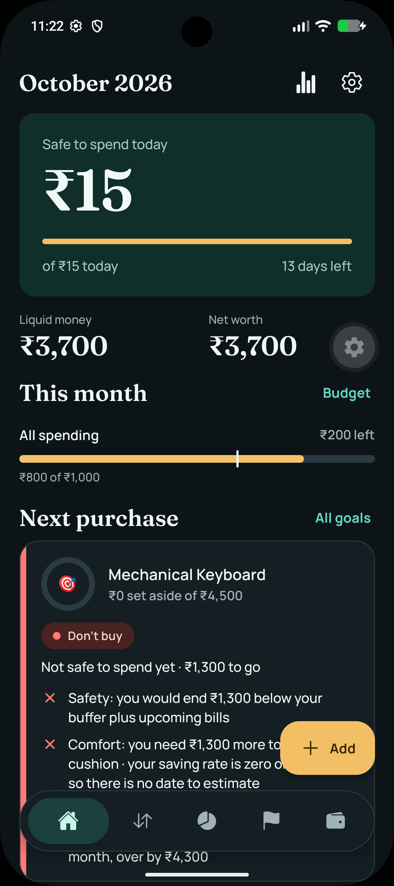
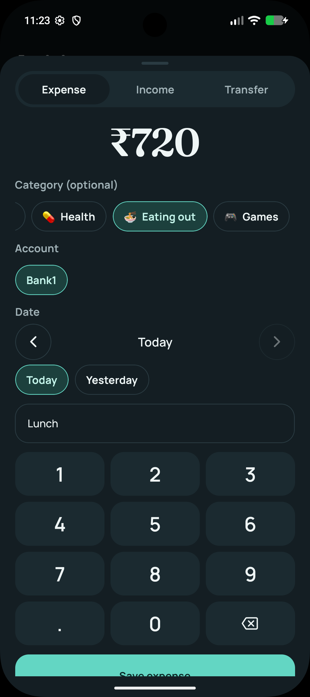
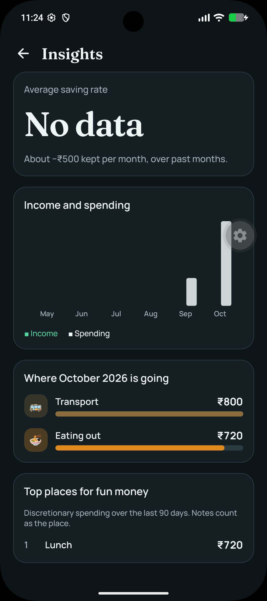
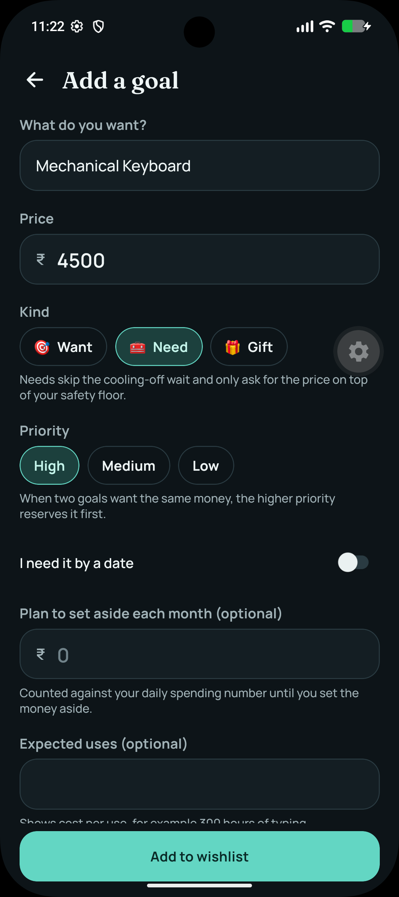
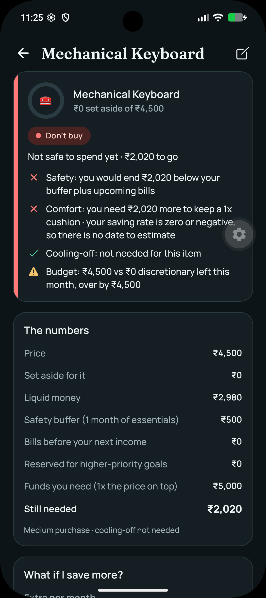

# Stash

[](https://opensource.org/licenses/MIT)
[](#)

Stash is a privacy-first personal money manager for Android. It answers two practical questions: *how much can I safely spend today?* and *is this purchase safe right now?*

Your financial data is stored locally on your device in an SQLite database rather than in a hosted service. 

> **Note:** While Stash is built with React Native and Expo (supporting iOS and Web), **the current primary focus and testing is strictly for Android.**

<p align="center">
  
  
  
  
  
</p>

## Download & Install

You can download the latest Android `.apk` directly from our [Releases page](../../releases). 
*Note: You may need to enable "Install unknown apps" in your Android settings to install the APK.*

## Why Stash
- **Safe-to-spend number:** Calculates today's available allowance after accounting for the monthly budget, spending, upcoming recurring bills, and the user's safety buffer.
- **Purchase verdicts:** Evaluates goals with explainable checks and labels such as *Buy now*, *Almost there*, *Keep saving*, and *Don't buy*.
- **Private by default:** Data lives in an app-private SQLite database. Optional biometric or device-PIN app locking is available.
- **Portable data:** Export a JSON backup or transaction CSV, import a JSON backup, and share backups through the platform share sheet. *(Treat exported files as sensitive financial data).*

## Getting Started (Development)

### Prerequisites
- Node.js LTS and npm
- Android Studio, an Android SDK, and an emulator or connected device for Android development

### Installation
Install dependencies from the repository root:
```bash
npm install
```

Start the Expo development server and run on Android:
```bash
npm run start
npm run android  # Build and run the native Android app
```

### Production Builds
The repository includes EAS build profiles. To generate an APK for internal distribution or GitHub releases:
```bash
npx eas build --platform android --profile preview
```
*(See `eas.json` for the complete profile configuration).*

### Contributing
Please see our [CONTRIBUTING.md](CONTRIBUTING.md) for details on our code of conduct, and the process for submitting pull requests.

### License
Stash is distributed under the MIT License.